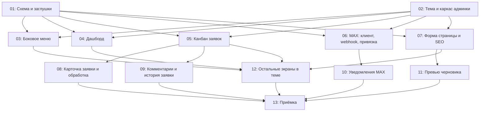

# Inex Glass — редизайн админки и уведомления MAX

## Overview

Заказчику не нравилась стандартная админка Payload: внешний вид, навигация, отсутствие дашборда и неудобная работа с заявками. Согласован макет (`res/admin-mockup/*.dc.html`, 4 экрана), который реализуется **внутри Payload 3.91**, без отдельной админки:

- своя тема (navy-меню `#324B64`, Rubik, токены сайта), только светлая, адаптив 375 / 1366 / 1920;
- своё боковое меню с группами и счётчиками;
- свой дашборд («Требует внимания», «Пульс», воронка, источники, заказы, последние заявки);
- канбан заявок с перетаскиванием (custom collection view);
- новая карточка заявки (вкладка «Сводка») с панелью обработки, комментариями и историей;
- форма редактирования страницы: счётчик и превью SEO, «Кем изменена», превью черновика;
- уведомления в мессенджер **MAX**: новая заявка, смена статуса, назначение, события заказов, напоминание «без ответственного > 2 ч»; групповой чат + личка ответственного.

Lexical остаётся. Всё сделанное в `specs/inex-glass-site/` (42 задачи) сохраняется.

## Quick Links

- [Requirements](./requirements.md) — требования, решения, критерии приёмки
- [Action Required](./action-required.md) — ручные шаги (бот MAX, webhook, сертификат)
- Макет: `res/admin-mockup/` (Main — дашборд, Leads — канбан, Lead — карточка, PageEdit — страница); онлайн: https://claude.ai/artifact/8XWFuX9tBMhD31u8nYyUkW
- MAX Bot API: `res/max-api/schema.yaml` (OpenAPI), https://dev.max.ru/docs-api

## Dependency Graph

## Waves

| Wave | Tasks | Description |
|------|-------|-------------|
| 1 | task-01, task-02 | Схема (миграция `admin_redesign`, `notification-log`, поля MAX, причины отказа, сумма КП, `updatedBy`, job-slug-и, все заглушки) ‖ тема, шрифт, конфиг админки, зависимости, SCSS-каркас |
| 2 | task-03 … task-07 | Меню, дашборд, канбан, ядро MAX, форма страницы |
| 3 | task-08 … task-12 | Карточка заявки, комментарии и история, уведомления MAX, превью черновика, остальные экраны |
| 4 | task-13 | Приёмка: e2e, скриншоты против макета, проверки, документация, Docker CA |

**Правила для оркестратора**
- **Схема.** Поля, коллекции, globals и slug-и заданий меняет **только task-01** (миграция `admin_redesign`, expand-only). Если в другой задаче не хватает поля, агент останавливается и сообщает координатору.
- **Правка `admin`/`hooks`** в файлах коллекций без изменения полей схемой не считается, но разрешена только там, где указано в таблице ниже.
- **Контракт той же волны.** Пометка «контракт той же волны» в «Depends on» означает: задачи идут параллельно, потребитель импортирует экспорт по оговорённому имени и пути, typecheck сходится после слияния волны.
- **Генерируемые файлы** (`src/payload-types.ts`, `src/app/(payload)/admin/importMap.js`, `src/migrations/index.ts`) коммитит только владелец волны:
  - волна 1 — task-01 (`payload-types.ts`, `migrations/*`) и task-02 (`importMap.js`, после слияния с заглушками task-01 координатор перегенерирует);
  - волна 2 — task-03;
  - волна 3 — task-08.
  
  Остальные задачи запускают генераторы локально и откатывают результат. После слияния каждой волны координатор выполняет `pnpm generate:types && pnpm generate:importmap` и проверяет diff (`payload-types.ts` после волн 2–4 меняться не должен).
- **`package.json` / `pnpm-lock.yaml`** — только task-02 (все зависимости спеки). Дальше не меняются.
- **Tailwind в админку не подключается.** Стили админки — SCSS с классами `.iga-*`; каждая задача пишет только в свой партиал (таблица ниже).
- В админке ссылки — обычный `<a>`, не `next/link`.
- Запуск dev/`payload run` перегенерирует `src/payload-types.ts` — откатывать, если задача не владелец.
- После каждой волны: `pnpm lint`, `pnpm typecheck`, `pnpm test`, `pnpm build`, код-ревью. Для UI — скриншоты 375 / 1366 / 1920 против `res/admin-mockup/`.

**Владение общими файлами**

| Файл | Создаёт | Кто меняет потом (волна) |
|---|---|---|
| `src/payload.config.ts` | — (есть) | 02 (W1: `admin.theme`, `meta`, `graphics`, `components.Nav`, `views.dashboard`, удаление `afterNavLinks`) → — |
| `src/app/(payload)/layout.tsx` | — | 02 (W1) |
| `src/app/(payload)/custom.scss` | — (пустой) | 02 (W1: только `@use` партиалов) |
| `src/app/(payload)/styles/_base.scss` | 02 | — |
| `src/app/(payload)/styles/_nav.scss` | 02 (пустой) | 03 (W2) |
| `src/app/(payload)/styles/_dashboard.scss` | 02 (пустой) | 04 (W2) |
| `src/app/(payload)/styles/_kanban.scss` | 02 (пустой) | 05 (W2) |
| `src/app/(payload)/styles/_max.scss` | 02 (пустой) | 06 (W2) |
| `src/app/(payload)/styles/_edit-form.scss` | 02 (пустой) | 07 (W2) |
| `src/app/(payload)/styles/_lead-card.scss` | 02 (пустой) | 08 (W3) |
| `src/app/(payload)/styles/_lead-history.scss` | 02 (пустой) | 09 (W3) |
| `src/app/(payload)/styles/_screens.scss` | 02 (пустой) | 12 (W3) |
| `src/styles/ig-vars.css` | 02 (вынос `:root` из `ig-tokens.css`) | — |
| `src/styles/ig-tokens.css` | — | 02 (W1: только `@import "./ig-vars.css"` вместо блока `:root`) |
| `package.json`, `pnpm-lock.yaml`, `pnpm-workspace.yaml` (`allowBuilds`) | — | 02 (W1) |
| `src/payload/collections/crm/leads.ts` | — | 01 (W1: поля, хуки) → 05 (W2: только `admin` — `views.kanban` и переключатель в `beforeList`; вкладка «Сводка» остаётся как есть) → в W3 не меняется |
| `src/payload/collections/crm/orders.ts` | — | 01 (W1: хук-заглушка `order-max-notify`) |
| `src/payload/collections/content/pages.ts` | — | 01 (W1: `updatedBy`, `admin.preview` → заглушка `src/lib/preview/preview-url.ts`) |
| `src/payload/collections/users.ts` | — | 01 (W1: поля MAX, ui-поле → `src/payload/admin/max/connect-button.tsx`) |
| `src/payload/globals/site-settings.ts` | — | 01 (W1: группа `notifications.max`, ui-поле → `src/payload/admin/max/group-link-panel.tsx`) |
| `src/payload/fields/seo.ts` | — | 01 (W1: `admin.components` → заглушки `src/payload/admin/seo/*`) |
| `src/payload/hooks/lead-status-validation.ts` | — | 01 (W1: код причины отказа) |
| `src/payload/hooks/lead-max-notify.ts`, `order-max-notify.ts` | 01 (no-op, подключены) | 10 (W3) |
| `src/jobs/index.ts` | — | 01 (W1: slug-и `max-notify`, `max-unassigned-reminder` со schedule) → — |
| `src/jobs/max-notify.ts`, `src/jobs/max-unassigned-reminder.ts` | 01 (заглушки) | 10 (W3) |
| `src/payload/admin/max/connect-button.tsx`, `group-link-panel.tsx` | 01 (заглушки) | 06 (W2) |
| `src/payload/admin/seo/seo-title-counter.tsx`, `seo-description-counter.tsx`, `seo-snippet-preview.tsx` | 01 (заглушки) | 07 (W2) |
| `src/payload/admin/nav/*` | 02 (заглушка `inex-nav.tsx`) | 03 (W2) → координатор (W3: подключение `DocTabsCurrent` из `src/payload/admin/doc-tabs-current.tsx` — исправление подсветки вкладок документа при `trailingSlash`) |
| `src/payload/admin/views/dashboard.tsx` | 02 (заглушка) | 04 (W2) |
| `src/payload/admin/leads/kanban/*` | 05 | — |
| `src/payload/admin/leads/lead-summary-view.tsx` | — (есть) | 05 (W2: не трогает) → 08 (W3) |
| `src/payload/admin/leads/history/*` | 09 | — |
| `src/lib/max/*` | 06 | 10 (W3: только `messages.ts`, `notify.ts` — новые файлы) |
| `src/lib/env.ts`, `env.example` | — | 06 (W2: все переменные MAX) |
| `src/lib/preview/preview-url.ts` | 01 (заглушка) | 11 (W3) |
| Чтение черновика в загрузчиках `src/lib/cms/*` | — | 11 (W3) |
| `src/lib/leads-admin/erase.ts` | — | 10 (W3: удаление сообщений MAX и записей `notification-log`) |
| `e2e/admin-leads.spec.ts` | — | 09 (W3) |
| `e2e/acceptance/lead-flow.spec.ts` | — | 09 (W3) |
| `src/payload/collections/crm/index.ts`, `crm/constants.ts` (`LEAD_REFUSE_REASON_CODES`, опции журнала), `src/payload/access/index.ts` (`adminOrSelfFieldAccess`), `src/payload/hooks/lead-hooks.ts` (`validateRefuseReason`) | — | 01 (W1) |
| `src/jobs/shared.ts` | — | 01 (W1: `keepUpdatedBy` в `JOB_WRITE_CONTEXT`) → 10 (W3: `skipMaxNotify`) |
| `src/payload/admin/pages/updated-by-field.tsx` | 01 (заглушка) | 07 (W2) |
| `src/payload/admin/nav/reports-nav-link.tsx` | — | 03 (W2: удалить) |
| `src/payload/admin/dashboard/*`, `src/lib/admin-dashboard/*` | 04 | — |
| `src/payload/admin/leads/constants.ts` | — | 05 (W2: `LEADS_KANBAN_PATH`, `leadSummaryPath`) → 08 (W3: добавления) |
| `src/app/api/max/{webhook,link-token,unlink,status}/route.ts`, `src/payload/admin/max/use-max-status.ts`, `scripts/max-subscribe.ts` | 06 | — |
| `e2e/helpers/env.ts` | — | 06 (W2: тестовые `MAX_*`) → 13 (W4) |
| `src/payload/admin/leads/card/*`, `erase-menu-item.tsx` | — | 08 (W3) |
| `src/lib/leads-admin/erase.test.ts` | — | 10 (W3) |
| `src/app/(site)/layout.tsx` (баннер превью), `src/lib/cms/queries.ts` (`getPageByPath`) | — | 11 (W3) |
| `src/payload/admin/leads/{ui.tsx,cells/*,lead-list-quick-filters.tsx,export-panel.tsx}`, `views/leads-report.tsx`, `src/payload/admin/orders/*`, `src/payload/admin/media/*` (замена inline-цветов на `.iga-*`) | — | 12 (W3) |
| `.dockerignore`, `.env.test.example`, `docs/deploy.md`, `docs/reports/admin-redesign*` | — | 13 (W4) |
| Новые e2e: `admin-nav`, `admin-dashboard`, `admin-kanban`, `max-webhook`, `admin-page-edit` | 03, 04, 05, 06, 07 соответственно | — |
| `Dockerfile`, `docker-compose*.yml` (`NODE_EXTRA_CA_CERTS`) | — | 13 (W4) |
| `DESIGN.md` (раздел «Админка»), `AGENTS.md` | — | 13 (W4) |

## Контракты между задачами

Имена и пути ниже обязательны: задачи разных волн и параллельные задачи опираются на них.

**Схема (task-01, миграция `admin_redesign`)**
- `leads`: `refuseReasonCode` — select `expensive` «Дорого» / `other_supplier` «Выбрали другого поставщика» / `needs_installation` «Нужен монтаж» / `no_contact` «Не дозвонились» / `other` «Другое» (необязательное); `kpAmount` — number ≥ 0, «Сумма КП, ₽»; `updatedBy` — relationship → `users`, read-only, заполняет хук.
- `pages`: `updatedBy` — то же.
- Хук `src/payload/hooks/set-updated-by.ts` (`beforeChange`): `data.updatedBy = req.user?.id ?? null` (`null` = «Система»).
- `validateLeadStatusReason` (`src/payload/hooks/lead-status-validation.ts`): для статуса с `requiresReason` нужен `refuseReasonCode` **или** непустой `refuseReason`; при `refuseReasonCode = 'other'` текст обязателен; ошибка по пути `refuseReason` с прежним сообщением. В отчётах `code = null` при наличии текста = «Другое».
- `users`: `maxUserId` (text), `maxLinkedAt` (date), `maxBotStopped` (checkbox) — field access `systemOnly` на запись (`src/payload/collections/crm/field-access.ts`), чтение admin или сам пользователь; `maxLinkTokenHash` (text), `maxLinkTokenExpiresAt` (date) — `neverReadable`; ui-поле `maxConnect` → `src/payload/admin/max/connect-button.tsx`.
- `site-settings` → вкладка «Уведомления и заказы» → группа `notifications.max`: переключатели `newLead`, `statusChange`, `assigned`, `orderEvents`, `unassignedReminder` (checkbox, default `true`); `groupChatId`, `groupChatTitle`, `groupLinkedAt` (systemOnly); `groupLinkTokenHash`, `groupLinkTokenExpiresAt` (neverReadable); ui-поле `maxGroupLink` → `src/payload/admin/max/group-link-panel.tsx`.
- Коллекция `notification-log` (скрытая, `admin.hidden: true`, read — admin, запись только Local API): `key` (text, unique, index; формат `max:<event>:<leadId|orderId>[:<суффикс>]`, напр. `max:new-lead:<leadId>`, `max:status:<leadId>:<statusChangedAt ISO>`, `max:assigned:<leadId>:<assigneeId>`, `max:unassigned:<leadId>`, `max:order:<orderId>:<status>`; к ключу добавляется канал `:group` или `:user:<userId>`, к назначению — `:<jobId>`), `channel` (select `group`/`user`), `event` (select `new_lead`/`status_change`/`assigned`/`order_event`/`unassigned_reminder`), `lead` (rel), `order` (rel), `recipient` (rel → users, необязательное), `chatId` (text), `messageId` (text), `status` (select `pending`/`sent`/`failed`/`skipped`), `error` (text), `sentAt` (date). Без версий.
- Задания: `max-notify` (input `{ event: 'new_lead'|'status_change'|'assigned'|'order_event', leadId?: string, orderId?: string, assigneeId?: string, statusChangedAt?: string, previousStatus?: string, orderStatus?: string }`, ретраи как `MAIL_RETRIES` из `src/jobs/shared.ts`) и `max-unassigned-reminder` (без input, `schedule: [{ cron: '*/15 * * * *', queue: MAINTENANCE_QUEUE }]`, как `expire-order-links.ts`; schedule живёт в `max-unassigned-reminder.ts` — task-10 не меняет slug, input и schedule). Хендлеры-заглушки `src/jobs/max-notify.ts`, `src/jobs/max-unassigned-reminder.ts` (no-op, возвращают `{ output: {} }`).
- Хуки-заглушки (no-op, уже подключены): `src/payload/hooks/lead-max-notify.ts` → `export const leadMaxNotify: CollectionAfterChangeHook` в `leads.hooks.afterChange`; `src/payload/hooks/order-max-notify.ts` → `export const orderMaxNotify` в `orders.hooks.afterChange`.
- SEO: `src/payload/fields/seo.ts` — `admin.components.afterInput` у `seo.title` / `seo.description` → заглушки `src/payload/admin/seo/seo-title-counter.tsx`, `seo-description-counter.tsx`; ui-поле `seoSnippet` → `src/payload/admin/seo/seo-snippet-preview.tsx`. Без изменения колонок БД.
- `pages.admin.preview` → `buildPreviewUrl` из `src/lib/preview/preview-url.ts` (заглушка возвращает `null`).

**Каркас (task-02)**
- `admin.components.Nav` → `src/payload/admin/nav/inex-nav.tsx` (`export default`/named `InexNav`, заглушка рендерит стандартное меню); `admin.components.views.dashboard.Component` → `src/payload/admin/views/dashboard.tsx` (заглушка, экспорт `InexDashboard`); графика — `AdminLogo`, `AdminIcon` (`src/payload/admin/graphics/`). `afterNavLinks` (ReportsNavLink) удаляется; ссылка `/admin/leads-report/` переезжает в меню task-03 (пункт «Отчёты», id `nav-leads-report` сохранить; файл `reports-nav-link.tsx` удаляет task-03).
- Базовые классы `_base.scss`: `.iga-card`, `.iga-btn` (`--primary|--secondary|--ghost|--danger`, `--sm`), `.iga-badge` (`--new|--work|--kp|--ok|--no` + произвольный цвет через `--iga-badge-color`), `.iga-tag`, `.iga-chip` (`[aria-pressed=true]`), `.iga-seg`, `.iga-input`, `.iga-select`, `.iga-field`, `.iga-dl`, `.iga-bar`, `.iga-page-head`, `.iga-section-head`, `.iga-avatar` (`--sm`). Компоненты задач используют их и добавляют своё только в свой партиал.

**MAX (task-06 → task-10)**
- `src/lib/max/client.ts`: `maxSendMessage({ chatId?: string, userId?: string, text: string, buttons?: { text: string; url: string }[][], notify?: boolean }): Promise<{ messageId: string }>`; `maxDeleteMessage(messageId: string): Promise<void>`; `class MaxApiError extends Error { status: number; code?: string; permanent: boolean }` (401/403/404 → `permanent: true`; 2xx без id сообщения → `permanent: true`, код `MAX_UNCONFIRMED_CODE`; `retryAfterMs` из `Retry-After` при 429/503).
- `src/lib/max/target.ts`: `resolveMaxTarget({ chatId?, userId? })` — если `SITE_ENV !== 'production'`, подменяет адресата на `MAX_INTERCEPT_CHAT_ID` или возвращает `null` (не слать); если `MAX_ENABLED !== 'true'` — `null`.
- `src/lib/max/html.ts`: `escapeHtml`, `truncateMaxText` (≤ 4000).
- `src/lib/max/link-token.ts`: генерация одноразового токена `ig_` + 32 символа base64url (бот реагирует только на свой префикс; без него — молчит), `hashToken` (SHA-256), проверка срока (30 мин); код группы — `INEX-XXXXXXXX`, засчитывается только отдельным сообщением.
- Webhook: `POST /api/max/webhook/` (`src/app/api/max/webhook/route.ts`). Необязательная env `MAX_API_BASE_URL` (по умолчанию `https://platform-api2.max.ru`) — для моков. Токен привязки: `POST /api/max/link-token/`. Подписка: `pnpm payload run scripts/max-subscribe.ts`.

**Карточка заявки (волна 3, контракт той же волны 08 ↔ 09)**
- task-09 экспортирует `LeadHistory` (server, `src/payload/admin/leads/history/lead-history.tsx`, props `{ leadId: string }`) и `LeadComments` (client, `src/payload/admin/leads/history/lead-comments.tsx`, props `{ leadId: string; comments: { id: string; author: string | null; text: string; date: string }[]; currentUserId: string }`). task-08 вставляет их в `lead-summary-view.tsx`.
- Ссылка на карточку из канбана, дашборда и MAX: `/admin/collections/leads/<id>/summary/` (со слешем, `trailingSlash: true`).

## Task Status

### Wave 1
- [x] [task-01-schema-and-stubs](./tasks/task-01-schema-and-stubs.md) — Схема `admin_redesign`, `notification-log`, job-slug-и, все заглушки
- [x] [task-02-admin-theme-foundation](./tasks/task-02-admin-theme-foundation.md) — Тема, шрифт, конфиг админки, зависимости, SCSS-каркас

### Wave 2
- [x] [task-03-admin-nav](./tasks/task-03-admin-nav.md) — Боковое меню с группами и счётчиками
- [x] [task-04-admin-dashboard](./tasks/task-04-admin-dashboard.md) — Дашборд
- [x] [task-05-leads-kanban](./tasks/task-05-leads-kanban.md) — Канбан заявок
- [x] [task-06-max-core](./tasks/task-06-max-core.md) — MAX: клиент, webhook, привязка лички и группы
- [x] [task-07-page-edit-form](./tasks/task-07-page-edit-form.md) — Форма страницы: SEO-счётчики, сниппет, «Кем изменена»

### Wave 3
- [x] [task-08-lead-card-processing](./tasks/task-08-lead-card-processing.md) — Карточка заявки и панель обработки
- [x] [task-09-lead-history-comments](./tasks/task-09-lead-history-comments.md) — Комментарии и история заявки, e2e карточки
- [x] [task-10-max-notifications](./tasks/task-10-max-notifications.md) — Уведомления MAX и напоминание
- [x] [task-11-draft-preview](./tasks/task-11-draft-preview.md) — Превью черновика страницы
- [x] [task-12-admin-screens-theme](./tasks/task-12-admin-screens-theme.md) — Остальные экраны в теме

### Wave 4
- [x] [task-13-acceptance](./tasks/task-13-acceptance.md) — Приёмка, документация, Docker CA

## Решения, принятые при декомпозиции

- `updatedBy`: задания очереди пишут с `context.keepUpdatedBy` (в `JOB_WRITE_CONTEXT`), чтобы не затирать автора правки «Системой». У поля `maxDepth: 0`; имя автора задачи получают отдельным запросом.
- Период канбана по умолчанию — «За всё время» (иначе старые открытые заявки выпадают из колонок).
- SEO остаётся на своей вкладке (перенос в сайдбар менял бы схему); счётчики 70 / 170.
- «Заявки» в меню ведут на канбан; неразмеченные коллекции попадают в «Система → Служебное».
- События заказа для MAX: «заказ создан» и «смена статуса» (полей «клиент открыл ссылку» нет).
- Известное несоответствие: менеджер сейчас может **редактировать** глобалы `prices` и `promo` (доступ не меняется этой спекой).
