# Inex Glass — сайт inexglass.ru

## Overview

B2B-сайт комплектатора закалённого стекла Inex Glass. Технологии: Next.js 16.4 и встроенная Payload CMS 3.91 на Postgres, деплой в Dokploy на VDS.

Что входит в первый этап:
- 70 публичных страниц P0–P3: каталог, обработка, конструкции, остекление, сервис, «Для кого», компания, объекты, блог, калькуляторы.
- Квиз «Расчёт стоимости» с загрузкой чертежа.
- Модуль заявок, то есть CRM внутри админки.
- Страница заказа по ссылке без логина и письма клиенту о смене статуса.
- Справочники CMS: цены с правилом 45 дней, акция, условия, контакты, техпараметры.
- Техническое SEO, Яндекс.Метрика после согласия на cookie, соответствие 152-ФЗ.
- Импорт портфолио с inex.su.

Источники требований:
- `docs/inex/` — ТЗ, мета-теги, SSoT, структуры страниц, миграция.
- `res/inex-glass-handoff/` — дизайн-система, прототипы, тексты, задания.

## Quick Links

- [Requirements](./requirements.md) — требования, решения, критерии приёмки
- [Action Required](./action-required.md) — ручные шаги (Dokploy, DNS, SMTP, данные от Inex)

## Dependency Graph

```mermaid
graph TD
    t01["01: Фундамент Next+Payload"]
    t02["02: Тесты и CI"]
    t03["03: Docker / деплой spike"]
    t04["04: DESIGN.md / AGENTS.md"]
    t05["05: Токены и базовые примитивы"]
    t06["06: Схема: globals"]
    t07["07: Схема: контент и каталог"]
    t08["08: Схема: заявки и заказы"]
    t09["09: Генератор изображений kie.ai"]
    t10["10: Заморозка схемы, миграция, типы"]
    t11["11: Доменная логика"]
    t12["12: UI: формы"]
    t13["13: UI: контент"]
    t14["14: Шапка и подвал"]
    t15["15: Каркас страниц и SEO"]
    t16["16: Блоки, rich text, seed-каркас"]
    t17["17: Приём заявок и загрузка файлов"]
    t18["18: Почта и фоновые задачи"]
    t19["19: Яндекс.Метрика"]
    t20["20: Квиз"]
    t21["21: Модальные формы"]
    t22["22: Главная"]
    t23["23: Хаб и карточки толщин"]
    t24["24: Виды стекла"]
    t25["25: Обработка + калькулятор отверстий"]
    t26["26: Конструкции"]
    t27["27: Остекление и зеркала"]
    t28["28: Как заказать + сервис"]
    t29["29: Для кого, компания, ПДн"]
    t30["30: Объекты"]
    t31["31: Блог + калькулятор веса"]
    t32["32: Админка заявок"]
    t33["33: Заказы и /zakaz/"]
    t34["34: Маршруты квиза и модалка"]
    t35["35: Поиск по сайту"]
    t36["36: Sitemap, robots, IndexNow"]
    t37["37: Импорт с inex.su"]
    t38["38: Временные изображения в CMS"]
    t39["39: Производительность"]
    t40["40: Аудит контента и SEO"]
    t41["41: Prod-деплой и бэкапы"]
    t42["42: Финальная приёмка"]

    t01 --> t02 & t03 & t04 & t05 & t06 & t07 & t08 & t09
    t06 & t07 & t08 --> t10
    t02 --> t11
    t05 --> t12 & t13
    t10 & t12 & t13 --> t14
    t10 & t11 & t13 --> t15
    t10 & t11 & t12 & t13 --> t16
    t10 & t11 --> t17
    t10 --> t18
    t13 --> t19
    t14 & t15 & t16 & t17 & t19 --> t20 & t21
    t14 & t15 & t16 --> t22 & t23 & t24 & t25 & t26 & t27 & t28 & t29 & t30 & t31
    t17 & t18 --> t32
    t14 & t15 & t17 & t18 --> t33
    t20 --> t34
    t14 & t15 & t16 --> t35
    t15 & t16 & t18 --> t36
    t26 & t30 --> t37
    t09 & t16 & t22 & t23 & t24 & t25 & t26 & t27 & t28 & t29 & t30 & t31 --> t38
    t34 & t35 & t36 & t38 --> t39
    t34 & t35 & t36 & t37 & t38 --> t40
    t03 & t36 & t37 --> t41
    t39 & t40 & t41 --> t42
```

## Waves

| Wave | Tasks | Description |
|------|-------|-------------|
| 1 | task-01 | Фундамент: чистка стартера, Next 16.4 + Payload 3.91, роли, реестры, env, docker-compose, proxy |
| 2 | task-02 … task-09 | Тесты и CI, Docker-spike, документация дизайна, токены, три задачи схемы CMS, генератор изображений |
| 3 | task-10 … task-13 | Заморозка схемы (миграция контента, типы, реестр плагинов, предустановка зависимостей), доменная логика, UI-примитивы |
| 4 | task-14 … task-19 | Шапка и подвал, каркас страниц и SEO, рендер блоков и seed-каркас, приём заявок, почта и jobs (миграция очереди), Метрика |
| 5 | task-20 … task-33 | Вертикальные срезы: квиз, формы, все шаблоны и страницы с seed и e2e, админка заявок, заказы |
| 6 | task-34 … task-38 | Маршруты квиза, поиск, sitemap и robots, импорт с inex.su, временные изображения |
| 7 | task-39 … task-41 | Производительность, аудит контента и SEO, prod-деплой |
| 8 | task-42 | Финальная приёмка и выпуск |

**Правила для оркестратора**
- Схема Payload (коллекции, globals, блоки) меняется только в задачах 06–08 и 10. Исключения со своей миграцией, строго по одной на волну:
  - задача 18 (волна 4) — таблицы очереди `payload-jobs`. Она же регистрирует **все** slug заданий, включая заглушку `indexnow-submit` для задачи 36: slug задания входит в enum БД, и новое задание позже потребовало бы миграции;
  - задача 35 (волна 6) — коллекция `search`, колонка `tsv` и GIN-индекс.
- Правка `hooks`/`admin` в файлах коллекций без изменения полей схемой не считается. Такие правки разрешены только там, где это прямо указано: 32 — `leads.ts`, 33 — `orders.ts`, 38 — `media.ts`.
- Если в другой задаче не хватает поля, агент останавливается и сообщает координатору. Тот делает отдельное изменение схемы и миграцию.
- **Контракт той же волны.** В «Depends on» есть задачи той же волны с пометкой «контракт той же волны». Это не порядок выполнения: задачи идут параллельно, потребитель импортирует экспорт по оговорённому имени, а typecheck сходится после слияния волны.
- **Владение файлами.** В одной волне две задачи не правят один файл. Общие точки расширения создаются заранее как реестр или заглушка, позже меняется только файл-заглушка (см. таблицу ниже).
- **Генерируемые файлы** (`src/payload-types.ts`, `src/app/(payload)/admin/importMap.js`, `src/migrations/index.ts`) коммитит только владелец волны: 3 — task-10, 4 — task-18, 5 — task-32, 6 — task-35. Остальные задачи волны запускают генераторы только локально, для проверки. После слияния волны координатор выполняет `pnpm generate:types && pnpm generate:importmap` и проверяет diff.
- `package.json` и `pnpm-lock.yaml`: зависимости для волн 4–7 заранее ставит task-10. В волнах 4–6 `package.json` не меняется: task-37 использует предустановленные `cheerio` и `csv-parse`. В волне 7 файл правит только task-40 — она добавляет все script-алиасы волны, в том числе `perf:*`, `analyze` для task-39 и `smoke:prod` для task-41.
- CI (task-02) перед Playwright выполняет `pnpm seed --full`. Пока срезы — заглушки, команда всё равно завершается с кодом 0. E2E срезов волны 5 рассчитаны на полный сид.
- После каждой волны выполняются `pnpm lint`, `pnpm typecheck`, `pnpm test`, `pnpm build` и код-ревью.

**Владение общими файлами**

| Файл | Создаёт | Кто меняет потом (волна) |
|---|---|---|
| `src/payload.config.ts` | 01 | 10 (сборка реестров, подключение `plugins` и `db.afterSchemaInit` из реестра плагинов, W3) → 18 (`email`, `jobs`, W4) → 32 (`admin.components` — отчёт, W5) |
| `src/payload/plugins/{index,search,indexnow}.ts` | 10 (реестр и no-op заглушки) | 35 — `search.ts` (W6); 36 — `indexnow.ts` (W6) |
| `src/jobs/index.ts`, `src/jobs/indexnow.ts` | 18 (все задания, `indexnow` — заглушка) | 36 — только `src/jobs/indexnow.ts` (W6) |
| `src/payload/hooks/order-from-lead.ts` | 08 (no-op, уже подключён в `leads.afterChange`) | 33 (W5) |
| `src/payload/collections/crm/leads.ts` | 08 | 32 (`admin`, `hooks`, W5) |
| `src/payload/collections/crm/orders.ts` | 08 | 33 (`admin`, `hooks`, W5) |
| `src/app/(site)/layout.tsx` | 01 | 05 (W2) → 14 (W4) → 34 (слот `modal`, `PathTracker`, W6) |
| `src/seed/index.ts` (01 — заглушка CLI), `src/seed/minimal.ts` (в т. ч. статусы заявок), `src/seed/globals.ts` | 16 (W4; `index.ts` переписывает) | — (срезы уже зарегистрированы; task-32 сид не трогает) |
| `src/seed/slices/<slice>.ts` | 16 (заглушки) | владелец среза в W5 (22–31) |
| `src/components/blocks/render-blocks.tsx` (все 29 блоков) | 16 | — |
| Заглушки блоков `form-block`, `holes-calculator-block`, `weight-calculator-block`, `prices-table-block`, `contacts-map-block`, `requisites-block`, `team-grid-block` | 16 | 21, 25, 31, 23, 29, 29, 29 (W5) |
| `src/components/forms/registry.tsx`, `form-dialog-provider.tsx` | 15 | 21 (W5) |
| `src/lib/seo/doc-url.ts` | 16 | — (используют 35, 36) |
| `src/lib/seo/metadata.ts` | 15 | 36 (`verification`, W6) |
| `src/components/layout/header-search.tsx` | 14 | 35 (W6) |
| `src/components/page/not-found-content.tsx` | 15 | 35 (форма поиска, W6) |
| `next.config.ts` | 01 | 15 (W4, только флаг global-not-found) → 36 (`rewrites`, W6) → 39 (`images`, analyzer, W7) |
| `src/app/robots.ts`, `src/app/(site)/sitemap.ts` | 01 | 36 (W6): удаляет `robots.ts` и вместо него делает `app/robots.txt/route.ts`, `sitemap.ts` переписывает |
| `src/components/analytics/attribution.ts` (`captureAttribution`) | 19; монтируется глобально через `<Metrika/>` в layout | — (20/21 читают через адаптер `src/lib/client/attribution.ts`) |

## Task Status

### Wave 1
- [x] [task-01-foundation-payload-setup](./tasks/task-01-foundation-payload-setup.md) — Фундамент: Next 16.4 + Payload 3.91, чистка стартера

### Wave 2
- [ ] [task-02-testing-ci](./tasks/task-02-testing-ci.md) — Vitest, Playwright, GitHub Actions CI
- [ ] [task-03-docker-deploy-spike](./tasks/task-03-docker-deploy-spike.md) — Dockerfile, healthcheck, GHCR, staging в Dokploy
- [ ] [task-04-design-docs](./tasks/task-04-design-docs.md) — Новые DESIGN.md и AGENTS.md
- [ ] [task-05-design-tokens-shell-primitives](./tasks/task-05-design-tokens-shell-primitives.md) — Rubik, токены --ig-*, слои CSS, Container/Section/Hero/Button
- [ ] [task-06-schema-globals](./tasks/task-06-schema-globals.md) — Globals: цены, акция, условия, контакты, техпараметры, настройки, навигация
- [ ] [task-07-schema-content-catalog](./tasks/task-07-schema-content-catalog.md) — Коллекции контента и каталога, библиотека блоков
- [ ] [task-08-schema-crm](./tasks/task-08-schema-crm.md) — Заявки, статусы, файлы, заказы, consent-log, redirects
- [ ] [task-09-kie-image-generator](./tasks/task-09-kie-image-generator.md) — Генерация фонов и временных иллюстраций (kie.ai)

### Wave 3
- [ ] [task-10-schema-freeze](./tasks/task-10-schema-freeze.md) — Единственная миграция, payload-types, importMap
- [ ] [task-11-domain-lib](./tasks/task-11-domain-lib.md) — Доменная логика с тестами (цены, отверстия, вес, рабочие дни, квиз)
- [ ] [task-12-ui-form-primitives](./tasks/task-12-ui-form-primitives.md) — Примитивы форм
- [ ] [task-13-ui-content-primitives](./tasks/task-13-ui-content-primitives.md) — Примитивы контента, cookie-баннер, sticky-CTA

### Wave 4
- [ ] [task-14-site-header-footer](./tasks/task-14-site-header-footer.md) — Шапка, мега-меню, подвал, layout
- [ ] [task-15-page-framework-seo](./tasks/task-15-page-framework-seo.md) — Загрузчики CMS, мета, крошки, JSON-LD, 404, CTA квиза
- [ ] [task-16-blocks-render-miniseed](./tasks/task-16-blocks-render-miniseed.md) — Рендер блоков и Lexical с метками, seed-каркас
- [ ] [task-17-lead-intake-uploads](./tasks/task-17-lead-intake-uploads.md) — Загрузка файлов, создание заявок, антиспам
- [ ] [task-18-email-jobs](./tasks/task-18-email-jobs.md) — Письма (React Email) и Payload Jobs
- [ ] [task-19-metrika-analytics](./tasks/task-19-metrika-analytics.md) — Яндекс.Метрика после согласия, цели

### Wave 5
- [ ] [task-20-quiz-core](./tasks/task-20-quiz-core.md) — Квиз «Расчёт стоимости» (7 шагов)
- [ ] [task-21-forms-modals](./tasks/task-21-forms-modals.md) — Формы: чертёж, звонок, образец, под нагрузку, контакты
- [ ] [task-22-page-home](./tasks/task-22-page-home.md) — Главная
- [ ] [task-23-zak-hub-thicknesses](./tasks/task-23-zak-hub-thicknesses.md) — Хаб «Закалённое стекло» и 8 карточек толщин
- [ ] [task-24-glass-types](./tasks/task-24-glass-types.md) — Виды стекла и триплекс
- [ ] [task-25-processing](./tasks/task-25-processing.md) — Обработка стекла и калькулятор отверстий
- [ ] [task-26-constructions](./tasks/task-26-constructions.md) — Стеклянные конструкции
- [ ] [task-27-glazing-mirrors](./tasks/task-27-glazing-mirrors.md) — Остекление и зеркала
- [ ] [task-28-how-to-order](./tasks/task-28-how-to-order.md) — «Как заказать», сервисные страницы, проектирование
- [ ] [task-29-klientam-company-legal](./tasks/task-29-klientam-company-legal.md) — «Для кого», о компании, сотрудники, контакты, ПДн
- [ ] [task-30-objects](./tasks/task-30-objects.md) — Объекты: листинг, фильтры, карточка
- [ ] [task-31-blog-weight](./tasks/task-31-blog-weight.md) — Блог и калькулятор веса
- [ ] [task-32-admin-leads](./tasks/task-32-admin-leads.md) — Модуль заявок в админке (ТЗ §6.1)
- [ ] [task-33-orders](./tasks/task-33-orders.md) — Заказы и страница /zakaz/ (ТЗ §6.2)

### Wave 6
- [ ] [task-34-quiz-routing](./tasks/task-34-quiz-routing.md) — Страница и модалка квиза, «Мой расчёт»
- [ ] [task-35-site-search](./tasks/task-35-site-search.md) — Поиск по сайту (Postgres FTS)
- [ ] [task-36-sitemap-robots-indexnow](./tasks/task-36-sitemap-robots-indexnow.md) — sitemap, robots.txt, IndexNow, верификации
- [ ] [task-37-inex-import](./tasks/task-37-inex-import.md) — Импорт портфолио и душевых (Firecrawl), исправленный CSV
- [ ] [task-38-placeholder-media](./tasks/task-38-placeholder-media.md) — Загрузка временных изображений в CMS

### Wave 7
- [ ] [task-39-perf-images](./tasks/task-39-perf-images.md) — Производительность и изображения (CWV)
- [ ] [task-40-content-audit](./tasks/task-40-content-audit.md) — Аудит контента, SEO и частотностей (Wordkeeper), e2e по всем URL
- [ ] [task-41-prod-deploy](./tasks/task-41-prod-deploy.md) — Prod в Dokploy, домены, бэкапы

### Wave 8
- [ ] [task-42-final-acceptance](./tasks/task-42-final-acceptance.md) — Финальная приёмка и выпуск
