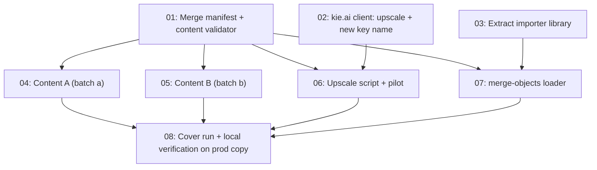

# Portfolio objects import (inex.su → «Объекты»)

## Overview

Merge the inex.su portfolio pages of the same real object into one `objects` card, fill the card content from the inex.su
texts and the photos, upscale only the cover photo via kie.ai, and load/publish 43 large objects (named, with a city, with
glass) via a committed idempotent script — verified on a local copy of the prod DB, then run on prod by the coordinator.
Decisions were made with the user on 2026-11-25 (see requirements.md).

## Quick Links

- [Requirements](./requirements.md) — full requirements and acceptance criteria
- [Action Required](./action-required.md) — manual steps needing human action
- [research/](./research/) — grouping of the Firecrawl cache: `objects-grouped.json` (137 groups), `pages.json` (per page:
  url, cat, slug, name, loc, city, kind=map label, coord, geos, photos[] URLs, task text, photoInfo), `inex-files.json`
  (sha1 → local file, w, h), `own-photos.json` (res/Объекты photos with sha1/dims), `group.cjs` (re-runs the grouping)

## Data contracts (shared by all tasks)

`scripts/import-inex/data/objects-manifest.json` (task 01 writes; tasks 04–08 read):

```ts
interface Manifest {
  generatedAt: string;
  objects: ManifestObject[];        // 43, stable order (xlsx objects first, then by photo count desc)
}
interface ManifestObject {
  slug: string;                     // xlsx slug if given; else existing prod placeholder slug; else objectSlugFromUrl(<new_url of the legacy path in docs/inex/12-migration-inex-su.csv>) (src/lib/migration/rules.ts, as import.ts does); else transliterated name
  batch: "a" | "b";                 // content batch: a = task 04, b = task 05 (total photo counts balanced between the batches)
  name: string;                     // display name, e.g. «ТРК «Родник»», «Сбербанк (Ишим)»
  city: string;                     // city name as on the site («Ханты-Мансийск», not the okrug)
  yearHint?: number;                // xlsx year, or page date year
  legacyUrls: string[];             // inex.su paths of member pages, e.g. /portfolio/ograzhdeniya/atriumnye/x
  categories: string[];             // inex.su categories of member pages (glass pages only)
  productHints: string[];           // product slugs derived from categories (see task 01)
  objectTypeHint?: string;          // xlsx type or map label heuristic
  xlsx?: Record<string, unknown>;   // the raw xlsx row (user data, overrides everything)
  sourceTexts: { url: string; title: string; text: string }[]; // inex.su page H1 + description (for rewriting)
  photos: ManifestPhoto[];          // all glass photos, sha1-deduplicated, default order (best first)
  // contact sheets (task 01): scripts/.import-tmp/sheets/<slug>-NN.jpg + sidecar <slug>-NN.json = ordered array [{ index, label (short key prefix), key (full sha1), file, width, height, origin, pageUrl? }]
  coverKey: string;                 // default cover = photos[0].key
  featuredDefault: boolean;         // true for the 8 home-marquee objects
  notes: string[];                  // data issues found while building
}
interface ManifestPhoto {
  key: string;                      // sha1 of the file bytes (40 hex)
  file: string;                     // repo-relative path: scripts/.import-tmp/photos/<sha1>/<name> or res/Объекты/<dir>/<file>
  sourceUrl?: string;               // https://inex.su/media/big/<name> (inex photos only; provenance/dedupe — NOT the kie.ai input, task 06 uploads the local file)
  origin: "inex" | "folder";
  pageUrl?: string;                 // inex.su page it came from
  width: number; height: number;
  caption?: string;                 // inex.su alt/caption if any
}
```

`scripts/import-inex/data/content/<slug>.json` (tasks 04/05 write; task 01 validator; task 07 reads):

```ts
interface ObjectContent {
  slug: string;                     // = manifest slug (file name)
  name: string;
  city: string;                     // existing city name or new one (created as data)
  objectType: string;               // existing object-type name or a new one from the allowed list (task 01 validator)
  year: number;                     // 1990..2027
  products: string[];               // existing product slugs only (see list below)
  task: string;                     // «Задача и сложность одной фразой», ≤300 chars, no stop-words
  spec: { product: string; thickness: string; kind?: string; triplexFormula?: string; processing?: string }[]; // ≥1
  chips: string[];                  // ≤3, ≤40 chars each, e.g. «Закалённый триплекс 8+8» (task 07 maps to the collection shape [{ text }])
  photos: { key: string; alt: string; caption?: string }[]; // ordered; first = cover; subset of manifest keys
  featured: boolean;
  related: string[];                // ≤4 other manifest slugs
  notes: string[];                  // «уточнить: …» items → importNotes
}
```

Shared exports / CLI contracts between tasks:
- task 01: `validate-content.ts` exports `validateAll({ manifest, contentDir, slugs? }): { errors, warnings }` (`slugs` = validate only those, global checks skipped) (the CLI runs only
  behind a main guard, so importing has no side effects); task 07 imports it (never spawns it).
- task 03: `MediaStore` takes the index-file path as a constructor option; `init()` loads media whose `sourceUrl` is like
  `inex.su` AND like `inex-objects:`; `fromLocalFile(file, { alt, sourceUrl, credit? })` dedupes by exact `sourceUrl`
  first (sha1 of the uploaded bytes is an optional extra). `Taxonomies`: `productBySlug(slug)` (find-only, throws if
  missing), `objectTypeByName(name, { create })`.
- task 07: `--out=<dir>` (default `scripts/.import-tmp`) for `slugs-objects.json`, the report and the media index;
  `--content=<dir>` for content files; temp WebPs under `os.tmpdir()`. Overwrite guard = KV markers `mayOverwrite` /
  `rememberSeedWrite` from `@/seed/context` (`src/seed/marker.ts`).

Prod reference values (2026-11-25):
- products: `dushevye-peregorodki` Душевые перегородки, `kozyrki` Козырьки, `ograzhdeniya` Ограждения,
  `osteklenie-verand-i-terras` Остекление веранд и террас, `peregorodki` Перегородки, `steklyannye-peregorodki`
  Стеклянные перегородки, `steklyannyj-fasad` Стеклянный фасад, `torgovye-vitriny` Торговые витрины, `tripleks` Триплекс,
  `zakalennoe-steklo` Закалённое стекло, `zerkala` Зеркала.
- object-types: Аэропорты, Арены, Банки, Концертный зал, Коттедж, Гостиницы, Офисы, Торговые центры.
- cities: Челябинск, Екатеринбург, Ишим, Казань, Кемерово, Красноярск, Новосибирск, Омск, Пермь, Самара, Сургут,
  Сыктывкар, Тюмень, Уфа, Волгоград.
- objects (seed placeholders to adopt by slug): aeroport-chelyabinsk, arkaim-plaza, glavnoe-upravlenie-surgutneftegaz,
  koncertnyj-zal-omsk, rmk-arena, sberbank-ishim, traktor-arena, trc-almaz-chelyabinsk (skip — no photos), trk-rodnik,
  trk-ural, ugorskaya-shahmatnaya-akademiya (drafts); tk-kolco (already PUBLISHED by the user with 6 photos — update
  only empty fields + add photos, never overwrite user edits — enforced by the seed KV markers `mayOverwrite`).
- Slug note: the prod placeholder and the xlsx use `koncertnyj-zal-omsk`, the redirect CSV has `koncertnyi-zal-omsk` (+ `-drugoe`,
  `-lestnica`): the existing placeholder slug is kept and task 08 fixes the redirects via the merged `slugs.json`.

## Dependency Graph



## Waves

| Wave | Tasks | Description |
|------|-------|-------------|
| 1 | task-01, task-02, task-03 | Manifest + validator, kie upscale client, importer library extraction |
| 2 | task-04, task-05, task-06, task-07 | Content writing (2 batches), upscale script + pilot only (stop for user approval), loader script |
| 3 | task-08 | Full cover run (approved model), load into a local copy of prod, audit, screenshots, redirect CSV |

Production run: coordinator only, after user approval — see action-required.md.

## File ownership

| File | Owner |
|---|---|
| `scripts/import-inex/build-manifest.ts`, `validate-content.ts`, `data/objects-manifest.json`, `scripts/.import-tmp/sheets/*` (contact sheets) | task 01 |
| `scripts/lib/kie.ts`, `scripts/gen-images.ts` (env name only) | task 02 |
| `scripts/import-inex/lib/*`, `scripts/import-inex/import.ts` | task 03 |
| `scripts/import-inex/data/content/<slug>.json` | task 04 (manifest objects with `batch: "a"`), task 05 (`batch: "b"`) |
| `scripts/import-inex/upscale-covers.ts`, pilot output `scripts/.import-tmp/covers/pilot/*` | task 06 |
| `scripts/.import-tmp/covers/*` (full run, by task 06's script) | task 08 |
| `scripts/import-inex/merge-objects.ts` | task 07 |
| `docs/reports/portfolio-objects-import.md`, `docs/inex/12-migration-inex-su.fixed.csv` and `docs/reports/migration-disputed.md` (both regenerated by `fix-csv.ts`) | task 08 |

The source CSV `docs/inex/12-migration-inex-su.csv` is never edited. No task changes `package.json`, `pnpm-lock.yaml`, `payload.config.ts`, collections or generated files.

## Task Status

### Wave 1
- [x] [task-01-merge-manifest](./tasks/task-01-merge-manifest.md) — Merge manifest builder + content validator
- [x] [task-02-kie-upscale-client](./tasks/task-02-kie-upscale-client.md) — kie.ai client: upscale models, file upload, new key name
- [x] [task-03-importer-library](./tasks/task-03-importer-library.md) — Extract reusable importer library from import.ts

### Wave 2
- [x] [task-04-content-a](./tasks/task-04-content-a.md) — Card content for manifest batch a
- [x] [task-05-content-b](./tasks/task-05-content-b.md) — Card content for manifest batch b
- [x] [task-06-upscale-covers](./tasks/task-06-upscale-covers.md) — Upscale script + pilot only (stop for user approval)
- [x] [task-07-merge-objects-loader](./tasks/task-07-merge-objects-loader.md) — merge-objects.ts loader/publisher

### Wave 3
- [x] [task-08-local-verification](./tasks/task-08-local-verification.md) — Full cover run, load into a local prod copy, audit, screenshots, redirect CSV
